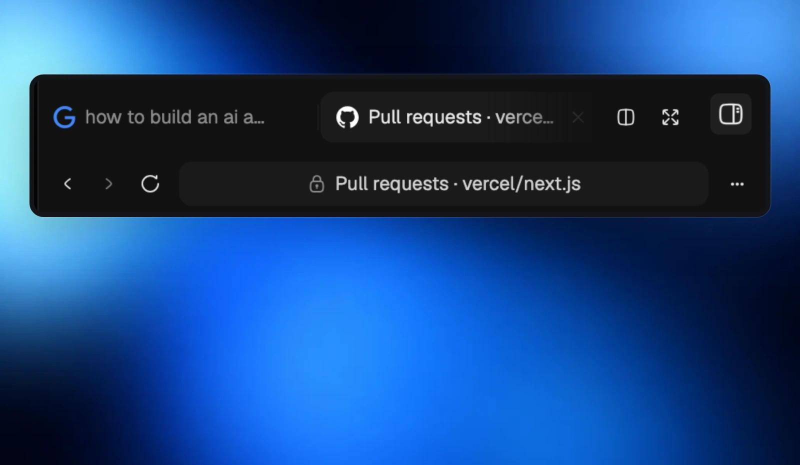
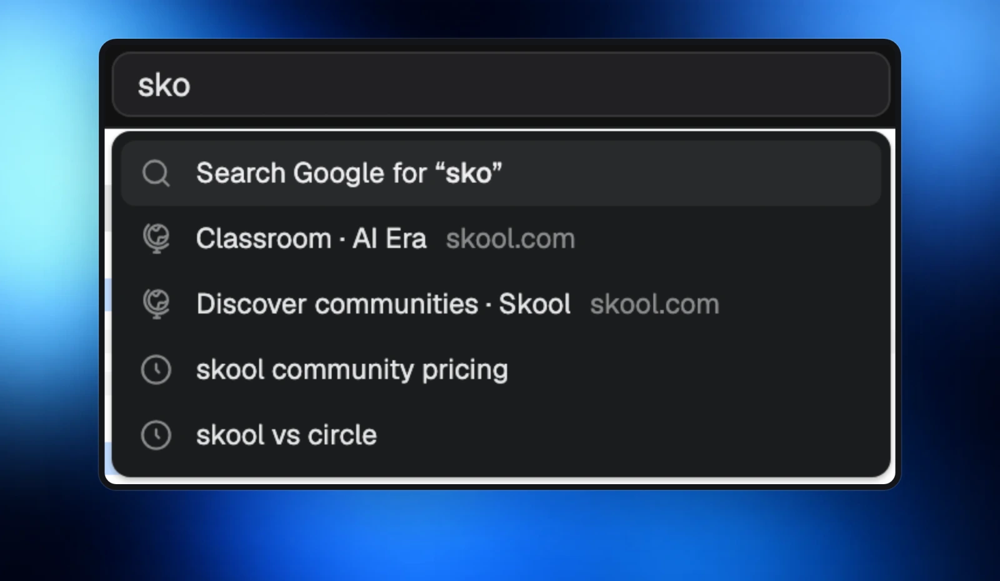
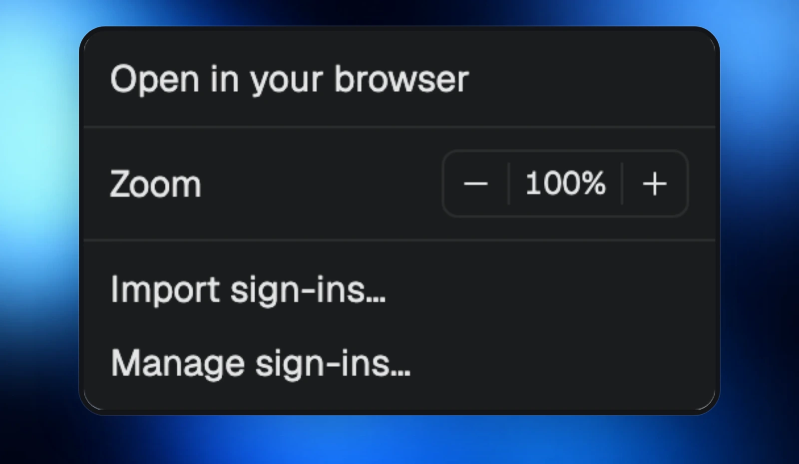

Your side panel now has a full browser. Tabs remember where you left them, with real page titles and favicons, so you can return to the right page at a glance.

## Search, open and keep going

Type a web address or search Google from the address bar. Suggestions bring your recent pages and searches within reach.

## Make room for your pages

Zoom in or out, and drag tabs to split your side panel. A sound indicator shows which tab is playing audio, with a mute control when you need quiet.

Pages resize smoothly, without white flashes. When a page cannot open, a Morphite-styled error page helps you get back on track.
