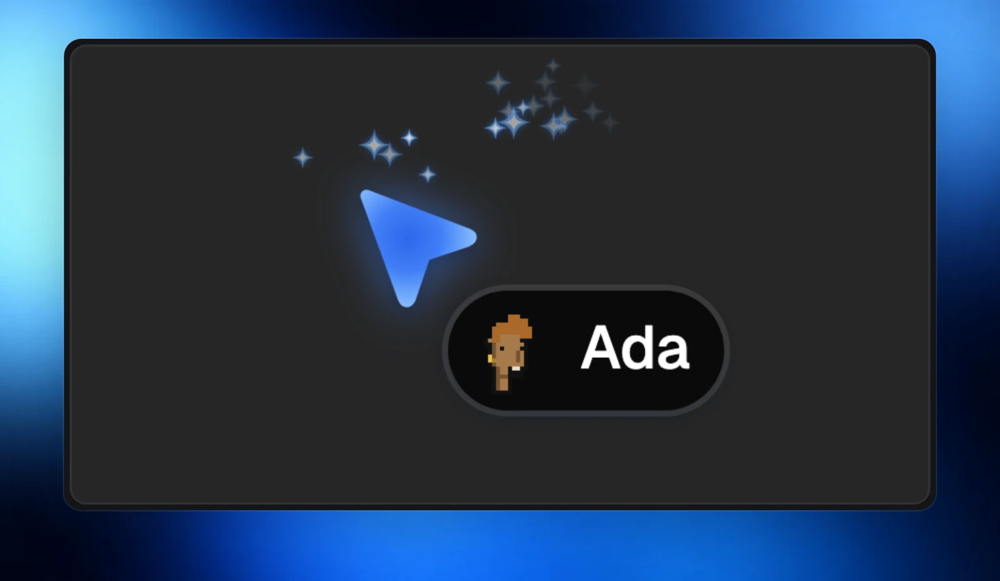
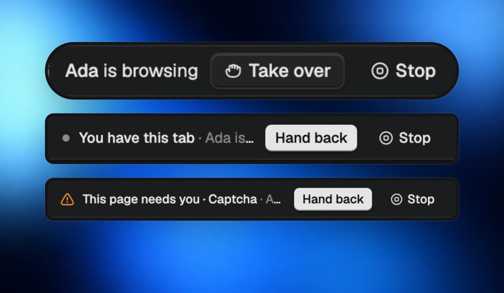
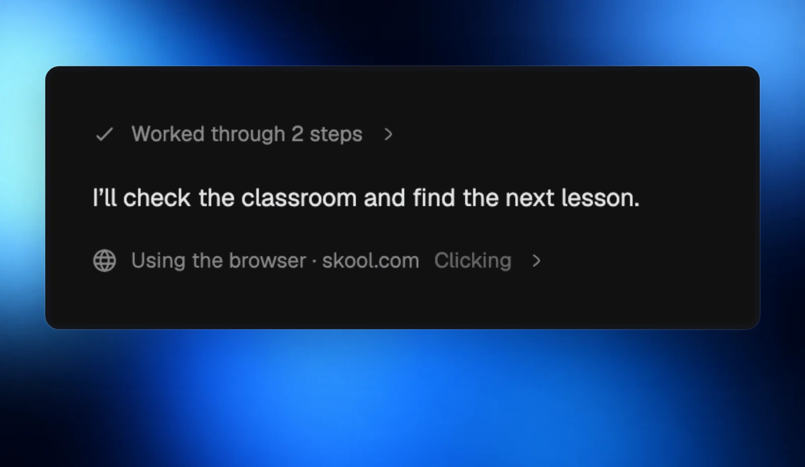

Your agents can open and use tabs in your side panel with any of their tools. You can scroll, click and type alongside them while they work.

## See your agent at work

A soft blue edge, a glowing cursor with a sparkle trail, and the agent’s avatar show who is using the page and where they are going.

## Take over, then hand back

Use **Take over** whenever you want the controls. **Hand back** lets your agent continue, and **Stop** ends their browser work. Your agent hears about each change right away.

Captcha and payment pages are handed to you, so you can finish those steps yourself.

## Keep the conversation close

**Using the browser** rows in chat show what your agent is doing. Browser work can continue in the background, even with the Morphite window closed.

