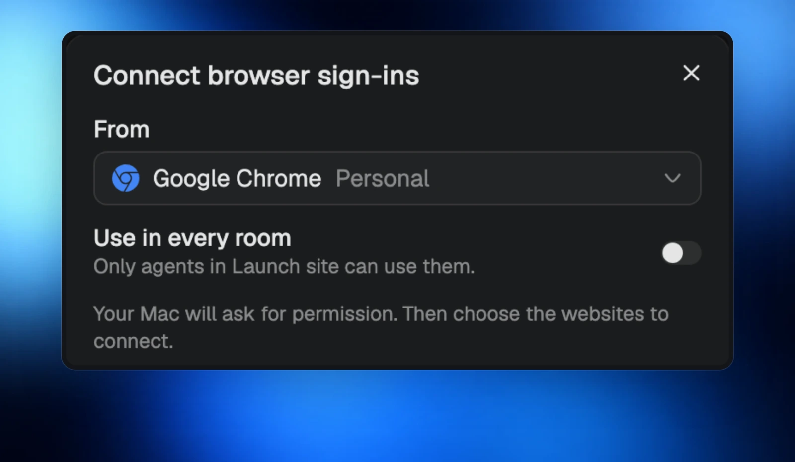
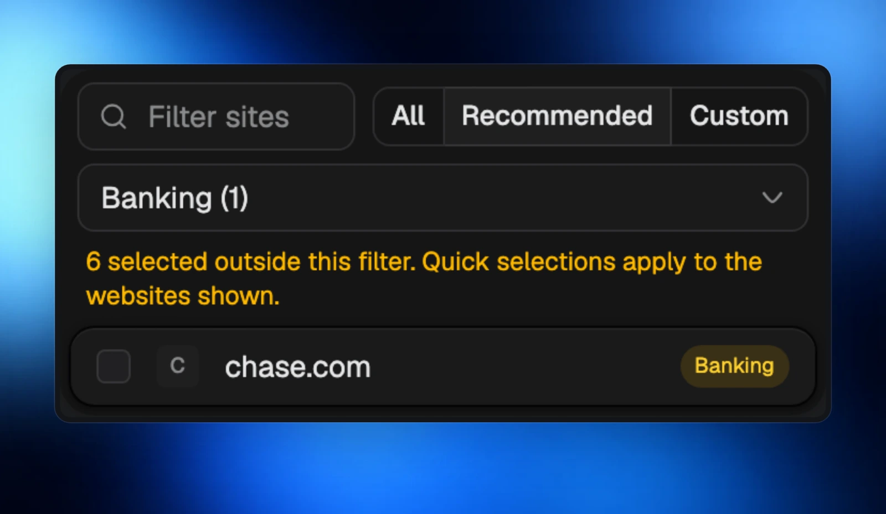
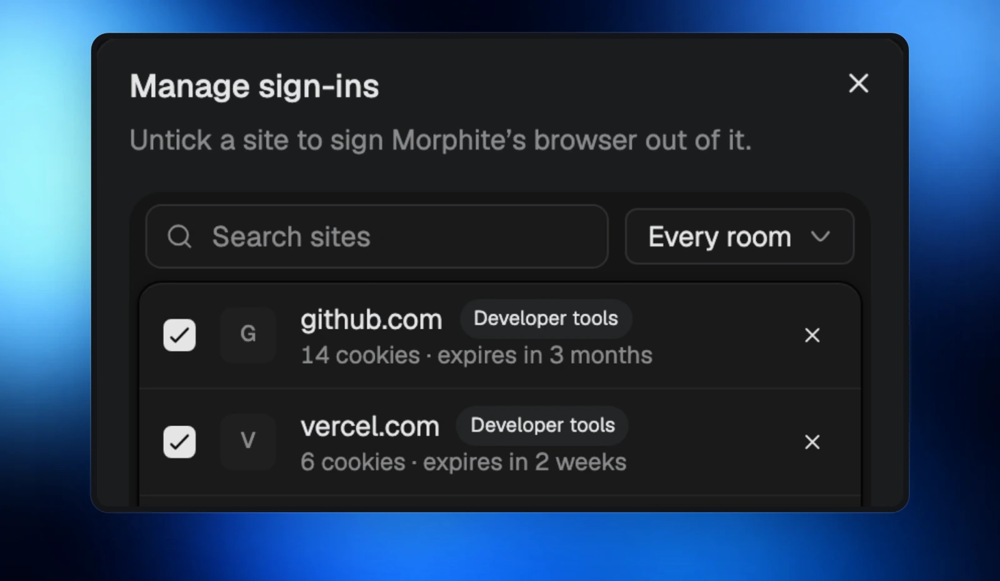

Bring sign-ins from **Chrome, Brave, Edge, Arc, Firefox or Safari** into Morphite. On the Mac, approve the import with **Touch ID**, then choose the websites to connect.

## Choose your browser and your rooms

Share the sign-ins with **every room**, or keep them in **one room**.

## Pick the websites you want

Banks are unticked by default. Choose the sites you want your agents to use before bringing them over.

## Find and manage saved sign-ins

**Manage sign-ins** and **Saved sign-ins** give you searchable lists, so you can find a website quickly and remove access when you are finished. **Clear history** clears your browsing history whenever you want a fresh start.

