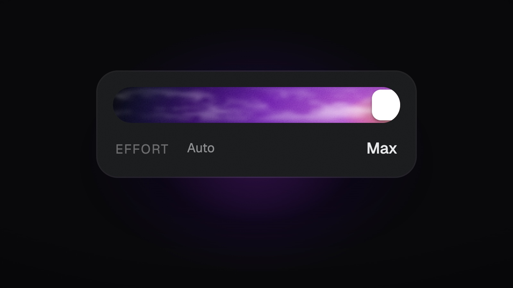
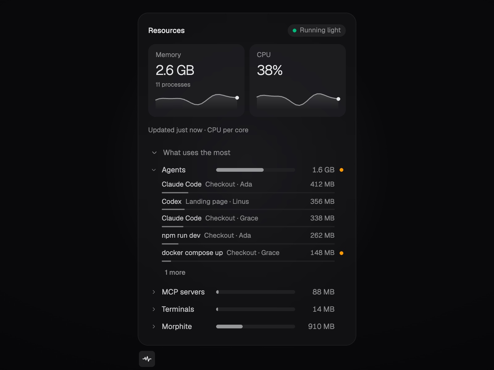
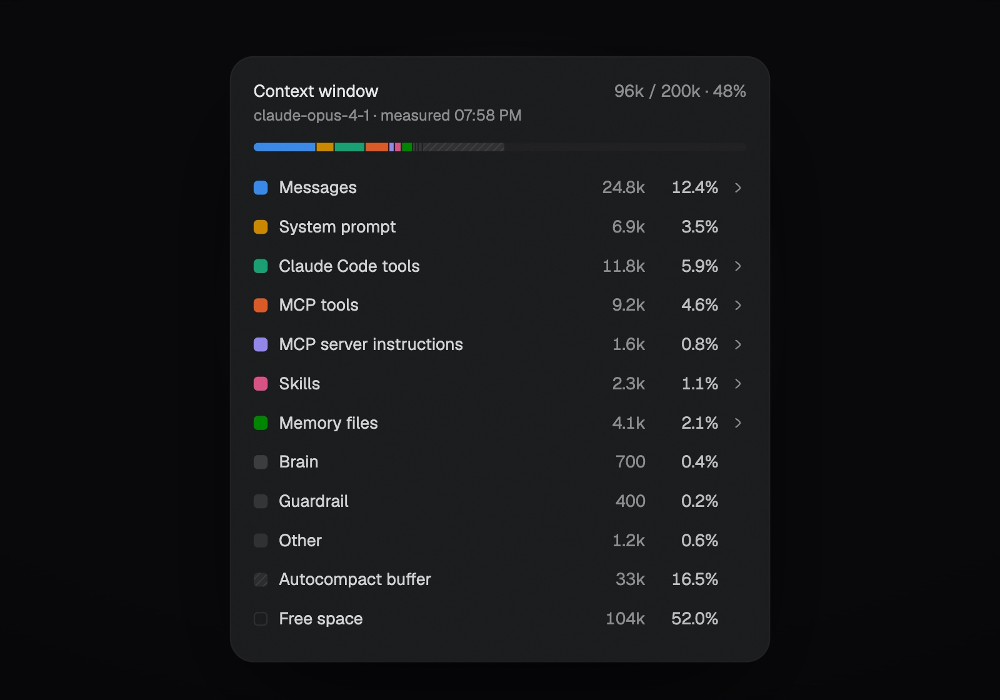

## Effort you can feel

Reasoning effort is now a slider. Click the meter next to the model, then drag or use the arrow keys through the model's own levels, from Low to Max. The level's name rolls in as it changes, and the higher you go, the more it glows. Auto keeps the provider's default.

## See what Morphite uses

The heartbeat icon next to What's New opens **Resources**: Morphite's memory and CPU right now, how they've moved over the last two minutes, and whether that's light or heavy for your computer. Open **What uses the most** to see agents, MCP servers, terminals and Morphite itself, and open any of them to see each program with its room and worker. An amber dot marks a program that kept running after its worker finished.

## Context, counted honestly

The context popover now shows what fills a chat's context window, measured by the provider, in colour again: messages, system prompt, tools, MCP servers, skills and memory files. It also says when every MCP tool is loaded, and which setting causes it.

## Long chats that fly

While an agent works, Morphite now sends your screen only what changed, a new line or a finished step, instead of the whole conversation every time. Long chats open quickly and stay smooth while agents stream, even when they're full of big tool outputs. Your computer does far less work in the meantime, which saves battery and memory. Large tool results load when you expand them, so they're there the moment you want them and out of the way when you don't.

## Improved

- Programs an agent leaves running now end with its worker on every computer, so fewer leftovers keep using memory.
- An idle chat's agent process now closes after five minutes, freeing its memory sooner.
- On a Mac, if Morphite's background process stops, the agents it started stop within seconds instead of running on.
- A conversation carried to another account or model now fits that model's context window, and continues the provider session where it can.
- Claude Code's built-in tools and skills are named and counted once in the context popover.

## Fixed

- Git works on locked-down Windows PCs and when Morphite runs as administrator, and when it can't use a Git it says why.
- **Jump to latest** scrolls all the way down again.
- A slider with one value no longer shows two handles.
- The company rail's hover preview stays open over an open page instead of flickering.
- A turn that fails before answering keeps its session, so the next message continues the same conversation.
